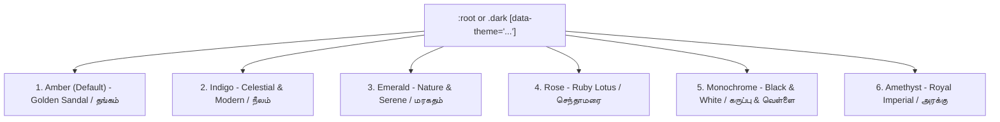
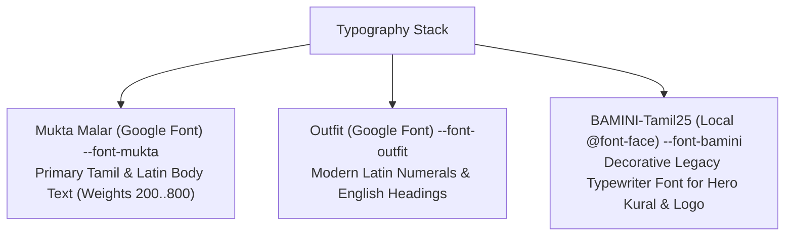

# Design System Reference: Thirukkural Web Application

This document establishes the official design system, typography guidelines, color palettes, glassmorphism tokens, and responsive behavior for the Thirukkural web explorer application.

---

## 1. Visual Identity & Aesthetic Philosophy

The Thirukkural application bridges **ancient Tamil poetic heritage** with **ultra-modern glassmorphic interface design**.

Key principles:
1. **Heritage & Authenticity**: Highlighting Saint Thiruvalluvar's wisdom through authentic Tamil typography, elegant quote glyphs, and scholarly commentaries.
2. **Glassmorphism & Depth**: Translucent surfaces (`backdrop-filter: blur(20px)`), frosted glass layers, crisp white/translucent borders, and soft multi-colored ambient radial background glows.
3. **Harmonious Dual Themes**: 6 distinct color themes inspired by classical Tamil and natural concepts, each offering carefully tuned Light and Dark modes.
4. **Accessible Poetics**: Displaying decorative typography (such as Bamini typewriter font) while rigorously preserving accessible Unicode Tamil text for screen readers via `aria-label`.

---

## 2. Color Palettes & CSS Variable System

The application implements 6 distinct dual-mode palettes configured in `app/globals.css` and selected via `lib/context/ThemeColorContext.tsx`.



### Color Palette Reference Table

| Theme ID | English Name | Tamil Name | Primary Color | Secondary Color | Key Character / Mood |
| :--- | :--- | :--- | :--- | :--- | :--- |
| `amber` (Default) | Golden Sandal | தங்கம் | `#f59e0b` / `#d97706` | `#f97316` / `#f59e0b` | Warm heritage, sandalwood, ancient parchment |
| `indigo` | Indigo | நீலம் | `#4f46e5` / `#818cf8` | `#06b6d4` / `#22d3ee` | Celestial, futuristic, scholarly clarity |
| `emerald` | Emerald | மரகதம் | `#059669` / `#34d399` | `#14b8a6` / `#2dd4bf` | Nature, tranquility, forest harmony |
| `rose` | Ruby Lotus | செந்தாமரை | `#e11d48` / `#fb7185` | `#db2777` / `#f472b6` | Bloom, passion, poetic warmth |
| `monochrome` | Black & White | கருப்பு & வெள்ளை | `#18181b` / `#f4f4f5` | `#52525b` / `#a1a1aa` | Minimalist, stark, classic editorial typography |
| `amethyst` | Royal Amethyst | அரக்கு | `#9333ea` / `#c084fc` | `#c026d3` / `#e879f9` | Imperial majesty, regal courts, deep gem |

### CSS Variables Generated per Theme

Every theme defines the following variables under both `:root[data-theme="<id>"]` and `.dark[data-theme="<id>"]`:

```css
--background: <hex>;            /* Base canvas background color */
--foreground: <hex>;            /* High-contrast readable text */
--gradient-1: <rgba>;           /* Top-left radial background glow */
--gradient-2: <rgba>;           /* Top-right radial background glow */
--gradient-3: <rgba>;           /* Bottom-right radial background glow */
--theme-primary: <hex>;         /* Brand accent, active links, primary buttons */
--theme-primary-hover: <hex>;   /* Hover state for primary buttons */
--theme-secondary: <hex>;       /* Secondary gradient stop */
--theme-quote: <rgba>;          /* Giant quotation mark glyphs */
--theme-badge-bg: <rgba>;       /* Pill badge background fill */
--theme-badge-border: <rgba>;   /* Pill badge and card border highlight */
--theme-badge-text: <hex>;      /* Text color inside badge pills */
--theme-hero-from: <hex>;       /* Hero text gradient start */
--theme-hero-via: <hex>;        /* Hero text gradient middle */
--theme-hero-to: <hex>;         /* Hero text gradient end */
--theme-dot: <hex>;             /* Animated ping dot indicator */
--theme-glow: <rgba>;           /* Soft box shadow glow color */
--theme-footer-bg: <hex>;       /* Footer background color */
```

### Ambient Canvas Background (`body`)
The page body features a fixed triple radial gradient blended with the base background:
```css
body {
  background:
    radial-gradient(at 0% 0%, var(--gradient-1), transparent 45%),
    radial-gradient(at 100% 0%, var(--gradient-2), transparent 45%),
    radial-gradient(at 100% 100%, var(--gradient-3), transparent 45%),
    var(--background);
  background-attachment: fixed;
  background-size: cover;
  color: var(--foreground);
  min-height: 100vh;
  font-family: var(--font-mukta), var(--font-outfit), sans-serif;
  transition: background 0.4s ease, color 0.4s ease;
}
```

---

## 3. Glassmorphism Utilities

Tailwind CSS v4 is augmented with standard glassmorphic classes defined in `app/globals.css`:

### Class Specifications

```css
/* Light Mode Glass */
.glass,
.glass-card,
.glass-input,
.glass-btn {
  background: rgba(255, 255, 255, 0.65);
  backdrop-filter: blur(20px) saturate(250%);
  -webkit-backdrop-filter: blur(20px) saturate(250%);
  border: 1px solid rgba(255, 255, 255, 1);
  box-shadow:
    0 10px 40px -10px rgba(0, 0, 0, 0.05),
    0 0 25px var(--theme-glow);
}

/* Dark Mode Glass */
.dark .glass,
.dark .glass-card,
.dark .glass-input,
.dark .glass-btn {
  background: rgba(15, 23, 42, 0.35);
  backdrop-filter: blur(12px);
  border: 1px solid rgba(255, 255, 255, 0.1);
  box-shadow: 0 4px 30px -10px var(--theme-glow);
}
```

- **`.glass-card`**: Base for cards, modals, and container blocks. Includes `@apply rounded-2xl shadow-xl hover:scale-[1.01] transition-transform duration-300;`.
- **`.glass-btn`**: Base for interactive pills, navigation controls, and pagination buttons. Includes `@apply px-4 py-2 rounded-xl hover:bg-white/20 transition-colors font-medium cursor-pointer active:scale-95;`.
- **`.glass-input`**: Search inputs and textareas with `@apply rounded-xl px-4 py-2 outline-none focus:ring-2 focus:ring-blue-400 placeholder-gray-500;`.

---

## 4. Typography & Font Hierarchy

The application integrates three distinct font families:



### Font Breakdown

1. **`Mukta_Malar` (`next/font/google`)**:
   - Subsets: `['tamil', 'latin']`.
   - Weights: `['200', '300', '400', '500', '600', '700', '800']`.
   - CSS Variable: `--font-mukta`.
   - Used for all standard Tamil text: Kural lines on cards and detail pages, commentaries, notes, and UI labels.
2. **`Outfit` (`next/font/google`)**:
   - Subsets: `['latin']`.
   - CSS Variable: `--font-outfit`.
   - Clean, geometric sans-serif used for English headings, numerals, and badges.
3. **`BAMINI-Tamil25` (`@font-face`)**:
   - Loaded from `/fonts/BAMINI-Tamil25.ttf`.
   - CSS Variable: `--font-bamini`.
   - Used exclusively for:
     - The header/footer logo wordmark ("திருக்குறள்").
     - The hero Daily Kural couplet on the home page.

---

## 5. Tamil Unicode to Bamini Conversion Engine

Legacy typewriter fonts like Bamini do not understand Unicode codepoints (`U+0B80` to `U+0BFF`). They assign glyphs to standard Latin keyboard keys (e.g. `க` -> `f`, `அ` -> `m`).

The application features a custom, battle-tested conversion utility in `lib/utils/bamini.ts`:

### Rules Implemented in `unicodeToBamini()`:
1. **Normalization**: Canonical NFC normalization (`text.normalize('NFC')`).
2. **Special Ligatures**: Grantha `ஸ்ரீ` -> `_`, `க்ஷ` -> `&`.
3. **Uyirmei U & UU Vowels**: Dedicated single-key mappings for combinations like `கூ` -> `$`, `சூ` -> `#`, `கு` -> `F`, `சு` -> `R`, `டி` -> `b`, `டீ` -> `B`.
4. **Two-part Compound Vowels**:
   - `ொ` (0BCA) -> `n` + consonant + `h`
   - `ோ` (0BCB) -> `N` + consonant + `h`
   - `ௌ` (0BCC) -> `n` + consonant + `s`
5. **Left-side Vowel Signs**:
   - `ெ` (0BC6) -> `n` + consonant
   - `ே` (0BC7) -> `N` + consonant
   - `ை` (0BC8) -> `i` + consonant
6. **Diacritics & Consonants**:
   - Pulli dot `்` (0BCD) -> `;`
   - Consonant table: `க:f`, `ச:r`, `ட:l`, `த:j`, `ப:g`, `ம:k`, `ய:a`, `ர:u`, `ல:y`, `வ:t`, `ழ:o`, `ள:s`, `ற:w`, `ன:d`.
   - Vowel table: `அ:m`, `ஆ:M`, `இ:,`, `ஈ:<`, `உ:c`, `ஊ:C`, `எ:v`, `ஏ:V`, `ஐ:I`, `ஒ:x`, `ஓ:X`.

### Accessibility Rule for Bamini Text
**CRITICAL**: When rendering text with `font-bamini`, ALWAYS provide the original Unicode Tamil string in `aria-label`:
```tsx
<p
  className="font-bamini text-3xl text-transparent bg-clip-text"
  aria-label={kural.line1_ta}
>
  {unicodeToBamini(kural.line1_ta)}
</p>
```

### Syllable Segmentation (`unicodeToBaminiSyllables`)
For logo rendering where letter-spacing (`gap`) is applied between glyphs, `unicodeToBaminiSyllables` uses `Intl.Segmenter` with `{ granularity: 'grapheme' }` so that vowel modifiers and pulli dots remain attached to their root consonant rather than drifting apart.

---

## 6. Layout & Responsive Breakpoints

The layout uses standard Tailwind breakpoints:
- `sm`: `640px` (Tablets & landscape phones)
- `md`: `768px` (Tablets & small laptops)
- `lg`: `1024px` (Desktop workstations)
- `xl`: `1280px` (Wide desktop)
- `2xl`: `1536px` (Ultra-wide desktop)

### Container Rules
- Root `<main>` container: `max-w-[1600px] mx-auto w-full px-4 pt-24 md:pt-28`.
- Kural Detail Page:
  - Without note: `max-w-5xl mx-auto`.
  - With custom note: Expands to `max-w-7xl 2xl:max-w-[1440px]`, splitting into a 12-column grid (`col-span-8` for Kural content, `col-span-4` sticky sidebar for notes).
- Home & Browse Grids:
  - 1 column on mobile (`grid-cols-1`).
  - 2 columns on tablet (`md:grid-cols-2`).
  - 3 columns on desktop (`lg:grid-cols-3`).

---

## 7. Animations & Micro-Interactions

1. **Rotation Animation**: The refresh button on the Daily Kural rotates 180 degrees over 450ms with `disabled` lock during animation.
2. **Glow Orbits**: AI Explanation cards feature high-impact ambient blur circles (`blur-[100px] bg-[var(--theme-glow)]`) that intensify on hover.
3. **Watermark Numbers**: Kural numbers are displayed as large, transparent watermark glyphs in card corners (`opacity-[0.08] font-serif font-black`).
4. **Scroll Smoothing**: `scroll-behavior: smooth` is applied by default, with automatic fallback to `scroll-behavior: auto` when `prefers-reduced-motion: reduce` is detected.
5. **Interactive Cursor**: All `a`, `button`, and `[role="button"]` elements enforce `cursor: pointer;`.
