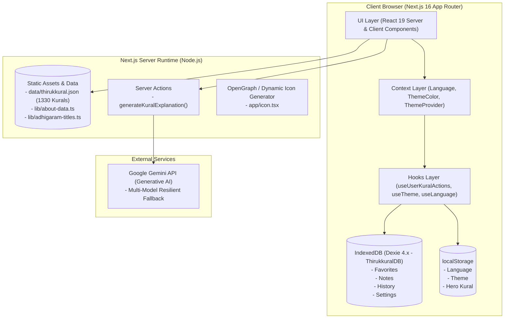
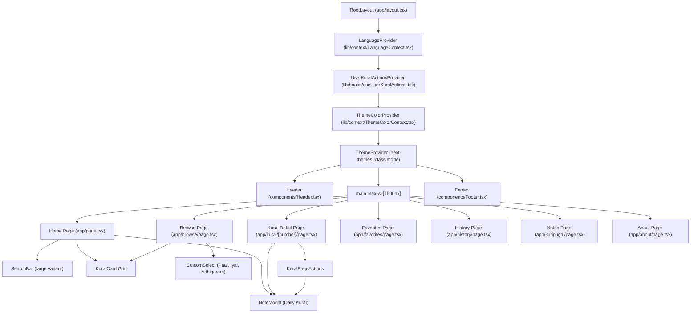
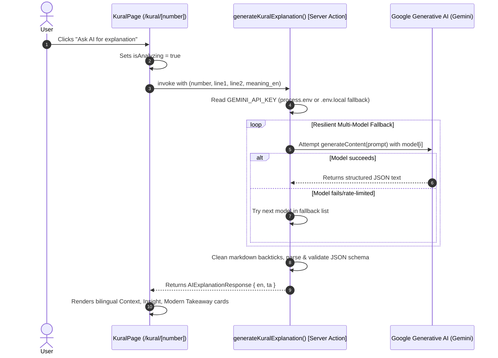

# Project Architecture Reference: Thirukkural Web Application

This document provides a comprehensive technical overview of the system architecture, component hierarchies, state management, data pipelines, and external integrations of the Thirukkural web explorer application.

---

## 1. System Overview & Technology Stack

The Thirukkural application is a modern, high-performance, culturally rich web explorer for the 1,330 couplets of Saint Thiruvalluvar. It is architected using Next.js 16 (App Router), React 19, TypeScript, Tailwind CSS v4, Dexie.js (IndexedDB), and Google Gemini Generative AI.



### Core Technologies

| Technology | Version / Spec | Role in Project | Key Implementation Detail |
| :--- | :--- | :--- | :--- |
| **Next.js** | `16.0.8` | Framework & App Router | Server Components, Server Actions (`use server`), Dynamic routing (`/kural/[number]`), OG image generation (`app/icon.tsx`) |
| **React** | `19.2.1` | View Engine | React 19 hooks (`use`, `useActionState`), client hydration management, portaled modals |
| **TypeScript** | `^5.x` | Type Safety | Strict typing across data models, Kural interfaces, and context states |
| **Tailwind CSS** | `^4.0.0` (`@tailwindcss/postcss`) | Design & Styling | `@theme` CSS variable tokens, glassmorphism utilities, CSS custom properties |
| **Dexie.js** | `4.4.7` (`dexie-react-hooks`) | Client Database (IndexedDB) | Reactive live queries (`useLiveQuery`), offline user persistence (Favorites, Notes, History) |
| **Google Generative AI** | `^0.24.1` (`@google/generative-ai`) | AI Analysis Engine | Gemini API integration via Next.js Server Action with multi-model fallback list |
| **Next-Themes** | `^0.4.6` | Theme Toggle | Class-based dark mode management synchronized with custom multi-palette CSS variables |

---

## 2. Component Architecture & Hierarchy

The application structure follows Next.js App Router conventions with distinct separation between root layout providers, route views, interactive presentation components, and modal dialogues.



### Layout Provider Hierarchy

1. **`LanguageProvider`**:
   - Manages active UI locale (`ta` | `en`).
   - Persists preference in `localStorage('app_language')`.
   - Exposes `language`, `setLanguage`, and translated string dictionary `t`.
2. **`UserKuralActionsProvider`**:
   - Initializes Dexie IndexedDB connection and requests persistent browser storage (`navigator.storage.persist()`).
   - Runs automated migration from legacy `localStorage('thirukkural_bookmarks')` and older Dexie schemas.
   - Provides reactive Dexie `useLiveQuery` hooks for:
     - `favorites`: User-bookmarked Kurals (Heart icon).
     - `notes`: Personal reflections & commentary (Bookmark icon / Kuripugal).
     - `history`: Recently browsed Kurals with timestamps.
3. **`ThemeColorProvider`**:
   - Manages the active color theme among 6 presets: Amber, Indigo, Emerald, Rose, Monochrome, Amethyst.
   - Sets `data-theme` attribute on `document.documentElement`.
   - Persists choice in `localStorage('thirukkural_color_theme')`.
4. **`ThemeProvider`** (`next-themes`):
   - Controls Light / Dark / System modes via the `.dark` CSS class on `<html>`.

---

## 3. Server Actions & External Integrations

### AI Explanation Architecture (`app/actions/generate-kural-explanation.ts`)

The AI explanation feature allows users to request contextual explanations, psychological insights, and modern practical takeaways for any of the 1,330 couplets.



#### Resilient Model Fallback Sequence
To maximize availability without hitting rate limits or deprecated model IDs, the Server Action cascades through the following prioritized models:
1. `gemini-2.5-flash` (Primary fast model)
2. `gemini-2.0-flash`
3. `gemini-1.5-flash`
4. `gemini-2.0-flash-exp`
5. `gemini-1.5-flash-latest`
6. `gemini-1.5-flash-001`
7. `gemini-1.5-flash-002`
8. `gemini-1.5-flash-8b`
9. `gemini-1.5-pro`
10. `gemini-1.5-pro-latest`
11. `gemini-pro`

#### Robust Key Extraction
`generateKuralExplanation` checks `process.env.GEMINI_API_KEY` first. If absent or corrupted in local dev, it reads `.env.local` directly, handling both UTF-8 and UTF-16 LE encodings and sanitizing trailing quotes or control characters.

---

## 4. Client-Side Data Storage & Reactivity (Dexie.js)

The application utilizes an IndexedDB database named `ThirukkuralDB` via Dexie.js for client-side persistence.

### Database Versions & Store Mapping (`lib/db.ts`)
- **Version 1**:
  - `bookmarks`: `'kuralNumber, createdAt'`
  - `history`: `'++id, kuralNumber, viewedAt'`
  - `settings`: `'key'`
- **Version 2**:
  - `notes`: `'kuralNumber, updatedAt'`
- **Version 3**:
  - `favorites`: `'kuralNumber, createdAt'`

### Reactive Live Queries (`dexie-react-hooks`)
Instead of manual event emitters or state sync, `useUserKuralActions` relies on Dexie's `useLiveQuery`:
```typescript
const liveFavorites = useLiveQuery(() => db.favorites.orderBy("createdAt").reverse().toArray(), [], []);
const liveNotes = useLiveQuery(() => db.notes.orderBy("updatedAt").reverse().toArray(), [], []);
const liveHistory = useLiveQuery(() => db.history.orderBy("viewedAt").reverse().toArray(), [], []);
```
When any component mutates `db.favorites`, `db.notes`, or `db.history`, all components across the app (header badges, cards, buttons) re-render immediately with updated counts and states.

---

## 5. SSR & Hydration Strategy

1. **Anti-Flash Theme Script**:
   An inline `<script>` in `app/layout.tsx` runs synchronously before DOM paint to read `thirukkural_color_theme` from `localStorage` and set `data-theme` on `document.documentElement`, preventing color theme flashing.
2. **Hydration Guards**:
   Components that access browser APIs (`localStorage`, `IndexedDB`, `window`) maintain a `mounted` state (`const [mounted, setMounted] = useState(false); useEffect(() => setMounted(true), [])`) to prevent React hydration mismatch errors.
3. **Deterministic Seeding for Daily Kural**:
   The Daily Kural on `app/page.tsx` uses an 8-hour time bucket hash algorithm:
   ```typescript
   const intervalMs = 8 * 60 * 60 * 1000;
   const timeBucket = Math.floor(now / intervalMs);
   // Deterministic string hash mod allKurals.length
   ```
   This ensures identical Kural selection across repeated renders within the 8-hour window, while allowing users to manually refresh and save a custom hero Kural via `localStorage('thirukkural_hero_kural')`.
4. **URL Query State in `/browse`**:
   The Browse page uses `useSearchParams()` wrapped inside `<Suspense>` to enable bookmarkable, shareable search filter URLs (`/browse?paal=...&iyal=...&adhigaram=...&page=...`) compatible with Next.js client-side navigation.
